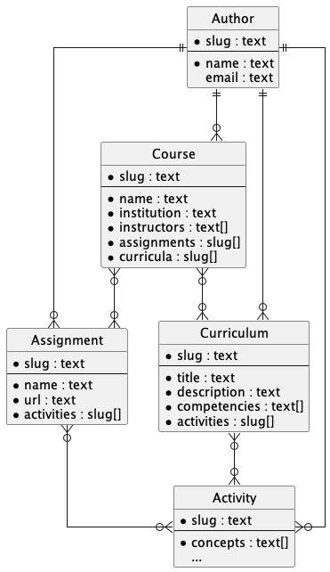

This repository contains the PyTamaro web plaform, served at https://pytamaro.si.usi.ch.

## Architecture

### Executive Summary
The web plaform is implemented using [Next.js](https://nextjs.org/).
The actual content is stored in separate repositories, one for each author, which are imported as git submodules.
Activities are created as [Jupyter notebooks](https://jupyter.org/).

### Content
Activites and curricula are responsiblity of a certain author and are maintained in external repositories.
See the [Luce repository](https://github.com/LuCEresearchlab/pytamaro-web-luce/) for an example.

Such repositories are imported to this repository as git submodules.
They can be added using the following command:
```sh
git submodule add <repository-url> data/<author-slug>
```

To fetch the submodules content, if not already done while cloning, run:
```sh
git submodule update --init
```

Work as usual by making changes to the files in the submodule's folder.
When you are ready, commit _inside_ a submodule folder and push to its `main` branch using:
```sh
git push origin HEAD:main
```

Merging the `main` branch of a submodule into its `live` branch will trigger
a workflow on the LuCE server that tries to build the plaftfrom with the new content.
In case of success, the reference to the submodule will be updated to the new commit
and the redeployment of the entire platform will be triggered.

Entity relationship diagram for our content:



### Activities
Activities are stored each in one folder inside the `data/<author-slug>/activities` folder.
The name of the folder should use hyphens and determines the _slug_ of the activity,
which uniquely identifies it.
See the `swiss-flag` activity for an example.

Each activity can exists in several variants,
depending on:
- the _natural language_ (e.g, English, Italian or German).

All the meta-information about an activity is specified in an `info.json` file.
See `data/luce/activities/swiss-flag/info.json` for an example.
Each variant is described by an object containing:
- the localized `title`,
- the natural language `language` in the ISO 639-1 format,
- the `latestVersion`.

These pieces of information prescribe the name of the Jupyter notebook file
for that variant (`slug-language-version.ipynb`).

There is a specific separate documentation [on how to write a notebook for an activity](docs/notebook.md).

Small changes (such as fixing a typo, or improving the wording of a markdown cell in a notebook)
should not be created in a new version.
On the other hand, major changes, including all the ones that involve the addition/removal of cells
should be created in a new version.

Note that user edits are persisted in the browser's local storage only with respect to a specific version.

Additionally, the object describing a activity contains the following fields:
- `previewImage`: an object containing the `filename` of a preview image and its `backgroundColor`, to be used in the gallery
- `visibility`: one of `"featured"` (shown first in the gallery with a special mark), `"visible"` (shown with normal priority in the gallery), `"draft"` (shown with a special "Coming soon" label in the gallery and only accessible using a direct link), or `"hidden"` (the activity is not shown at all in the gallery).

## How to set up a development environment

1. Clone this repository and all its submodules: `git clone --recurse-submodules git@github.com:LuCEresearchlab/pytamaro-web.git` 
1. Install the dependencies of this project: `npm install`
1. Populate the `public` folder with notebooks-related assets: `node tools/createNotebookAssets.js`
1. Start the Next.js server: `npm run dev`
1. Browse at [http://localhost:3000](http://localhost:3000)

## Coding guidelines

We use TypeScript and follow the AirBnB style guide.
Install ESLint in your environment.

We mostly follow the structure prescribed by Next.js:
- `pages` contains pages automatically discovered by Next.js's router
- `pages/api` contains API routes
- `components` contains our custom react components (factored out from pages as much as possible)
- `src` contains "business logic"
- `public` contains public assets
- `tools` contains extra utilities meant to be executed as scripts

## How to deploy

Pushes to the `live` branch trigger an automatic re-deployment.
One liner from the `main` branch:
```sh
git checkout live && git merge main && git push && git checkout main
```

## Configure Deployment

- Set up an instance of `glot` (see the `pytamaro-docker` repo)
- Create an appropriate `.env.production` in the root folder
- Navigate into the `docker` folder; execute `docker-compose --env-file ../.env.production build` to build the NextJS and Redis containers, and `docker compose --env-file ../.env.production up` to start them.
