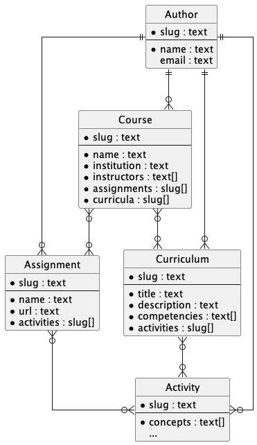

# What is in a Content Repository

A content repository is maintained by an author and contains activities and curricula.

The profile of an author is described in a file named `author.json`. It contains the following fields:

- `name`: the name of the author
- `description`: free description (e.g., institution, members of a group; supports Markdown)

### Activities

Each activity is available in variants.

> Each variant is specified in a Jupyter notebook file.

### Curricula

Curricula group activities together in a learning path.

Each curriculum is a sequence of units.

> Each unit is a sequence of steps that must be completed in order.

> > Each step contains multiple alternative activities; learners are required to complete at least one of them to complete the step. A step may be optional.

Each curriculum has a set of competencies.

> A competency may be used to define the prerequisites and learning objectives of the activities in the curriculum.

## ER Diagram

Entity relationship diagram for a content repository:

